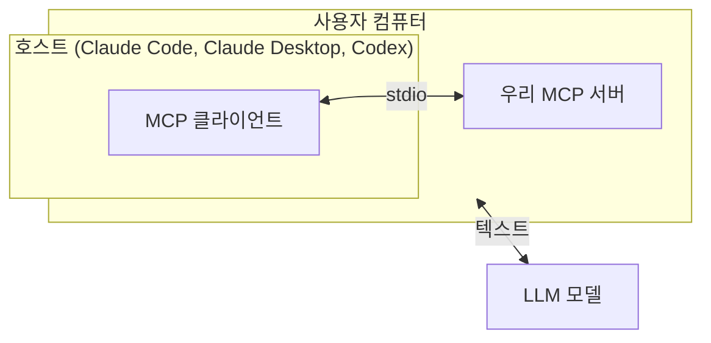
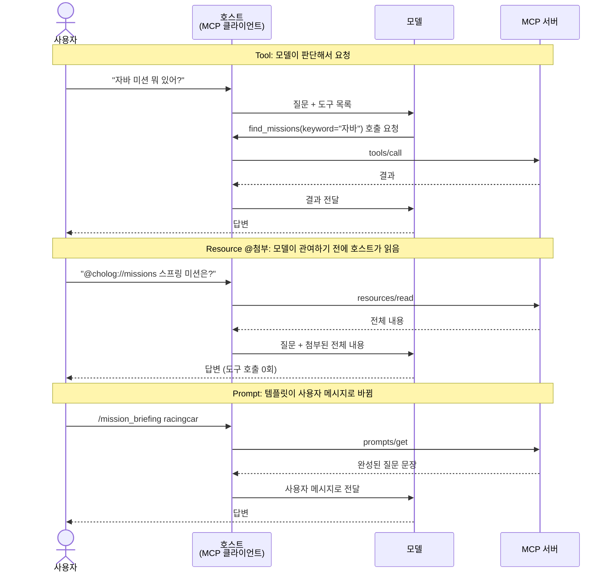

# MCP 설계 판단 기준

> 기록 문서다. 작성한 날의 내용 그대로이며 이후에 갱신하지 않는다. 지금의 기준은 [도구 명세](../tool-spec.md)다.
> 본문의 hello 서버(`playground/hello/`)는 저장소 밖의 실험용 서버다. "아직 모르는 것"의 앞 두 질문은 [품질 확인](2026-10-07-quality-check/README.md)에서 답을 얻었다.

- 작성: 2026-10-01 (Claude Desktop 결과 반영)
- 근거: [0] MCP 기초 확인 단계에서 hello 서버(`playground/hello/`)로 직접 관찰한 결과
- 용도: [2] 도구 명세를 쓸 때 "이건 Tool인가, Resource인가, Prompt인가"를 정하는 기준
- 공식 근거: [MCP Specification 2026-07-28](https://modelcontextprotocol.io/specification/2026-07-28) (최신판은 [`latest`](https://modelcontextprotocol.io/specification/latest))

각 기준에는 **근거**(어디서 확인했나)를 붙였다. 근거가 약한 것은 따로 표시했다.

---

## 1. 먼저 알아둘 구조

### 누가 무엇을 하나



- **모델은 도구를 직접 실행하지 않는다.** "이 도구를 이 인자로 불러줘"라는 텍스트를 내보낼 뿐이다.
- 실제 통신은 **호스트 안의 MCP 클라이언트**가 한다.
- 서버는 표준(MCP)만 지키면 어느 호스트에든 그대로 붙는다. 다른 것은 **호스트가 기능을 어떻게 노출하느냐**다.

### 세 가지 기능은 흐름이 다르다



### 세 가지 기능의 차이

스펙의 정의 ([Specification > Overview > Features](https://modelcontextprotocol.io/specification/2026-07-28)):

> - **Resources**: Context and data, for the user or the AI model to use
> - **Prompts**: Templated messages and workflows for users
> - **Tools**: Functions for the AI model to execute

Resource만 "사용자 **또는** 모델"이다. 실제로 누가 쓰게 할지는 **호스트가 정한다**.


| | 누가 주도 | 모델에게 도착하는 형태 | 비유 |
|---|---|---|---|
| Tool | 모델 | 도구 실행 결과 | 모델이 스스로 거는 전화 |
| Resource | 사용자 또는 모델 (호스트가 정함) | 질문에 붙은 첨부 데이터 | `@파일`처럼 끌어다 놓는 첨부파일 |
| Prompt | 사용자 | 사용자 메시지 그 자체 | 누르면 질문이 채워지는 매크로 버튼 |

---

## 2. 판단 기준

### 기준 1. 핵심 기능은 전부 Tool로 만든다

Resource와 Prompt는 지원하는 호스트에서만 보이는 **편의 기능**으로 얹는다.

**이유**: 호스트마다 Resource·Prompt를 발견하고 노출하는 방식이 다르다. 리드가 어떤 호스트를 쓸지 정해지지 않았으므로, 반드시 동작해야 하는 기능은 모든 호스트가 같은 방식으로 지원하는 Tool에 둔다.

**근거**

| | Tool | Resource 모델 자율 읽기 | Resource `@` 첨부 | Prompt |
|---|---|---|---|---|
| Claude Code | ✅ 확인 | ✅ 확인 (범용 도구로 2단계) | ✅ 확인 | ✅ 확인 (`/` 명령) |
| Codex | ✅ | ✅ | ❌ (기능 요청 중) | 불명확 |
| Claude Desktop | ✅ 확인 (허용 창 뜸) | ❌ Tool로 우회함 | `+` 메뉴 안쪽, TXT 파일로 첨부 | `+` 메뉴, 입력 팝업, TXT 파일로 첨부 |

Codex 행은 외부 조사 결과이며 직접 검증하지 않았다.

**결정적 근거 (Claude Desktop)**: "전체 미션 목록 보여줘"에 모델이 Resource 대신 `find_missions(keyword="")`로 우회했다. Resource 첨부 메뉴는 `+` → Connectors → Add from 서버 이름으로 세 단계 안쪽에 있다. 같은 서버가 호스트마다 거의 모든 면에서 다르게 보였다.

### 기준 2. 설명문을 API 문서처럼 쓴다

Tool의 docstring, Resource의 `description`은 **모델과 사용자가 읽는 사용 설명서**다.

- 모델은 Tool 설명만 보고 "지금 이 도구를 불러야 하나"를 판단한다.
- 사용자는 `@` 목록에서 Resource의 URI와 description을 보고 고른다.

**근거**: 도구 이름을 말하지 않은 질문("자바 미션 뭐 있어?")에 모델이 docstring과 질문을 맞춰보고 `find_missions`를 골랐다. `@` 목록에서 URI와 description이 함께 보였다.

**근거 강도: 약함.** 실험한 모델이 이미 서버 구조를 알고 있었다. 맥락 없는 세션에서 재검증 필요 ([5] 품질 검증에서).

### 기준 3. 파라미터는 선택지로 좁힌다

인자는 모델이 질문을 해석해서 **자율적으로** 채운다. 자유 문자열로 열어두면 예상하지 못한 값이 들어온다.

```python
# 열어두면: "racingcar", "자동차경주", "racing-car" 무엇이든 들어옴
def find_mistakes(mission_id: str): ...

# 좁히면: 입력 스키마에 선택지가 노출되고, 모델은 그 안에서만 고름
def find_mistakes(mission_id: Literal["calculator", "racingcar", "lotto",
                                      "ladder", "roomescape", "lunch"]): ...
```

Java의 `String` 대신 `enum`을 받는 것과 같다.

**근거**: 파이썬 타입 힌트가 그대로 입력 스키마(`{"keyword": {"type": "string"}}`)로 변환되는 것을 확인했다.

**참고 사례** (출처 불명, 판단 근거에서는 제외): 로그에 `find_missions(keyword="spring")` 호출이 남았다. 데이터에는 "스프링"으로 저장돼 있어 빈 결과가 나왔을 것이다.

**모델의 우회에 기대지 않는다.** Desktop에서 "전체 목록" 요청에 모델이 `keyword=""`로 우회했고, 파이썬에서 `"" in 문자열`이 참이라 우연히 성공했다. 실제로 필요한 동작(전체 목록 등)은 `list_missions()`처럼 **별도 Tool로 명시**한다.

### 기준 4. 큰 데이터는 Resource로 노출하지 않는다

`@`로 첨부하면 Resource **전체가 통째로** 모델의 컨텍스트에 들어간다. 잘라서 주는 기능이 없다.

- 미션 목록처럼 작은 데이터: Resource로 적합
- 미션 하나의 리뷰 전체(자동차 경주 기준 약 41만 자): Resource로 노출하면 안 됨. Tool로 필요한 만큼만 조회

**근거**: `@cholog-hello:cholog://missions` 첨부 시 JSON 전체가 질문 아래에 붙어서 도착했고, 호스트가 "이미 전체를 가졌으니 다시 읽지 말라"는 문구를 함께 붙였다.

### 기준 5. Prompt는 "검증된 질문"을 배포하는 데 쓴다

Prompt는 사용자가 메뉴에서 고르면 템플릿이 사용자 메시지로 펼쳐지는 기능이다.

- 리드가 좋은 질문을 고민하지 않아도 된다. 스파이크에서 검증한 질문 3개가 첫 후보다.
- 템플릿 안에 Tool 사용을 유도하는 문장을 넣어 **질문 + 데이터 조회 시나리오**를 만들 수 있다.
- 사용할 때마다 서버에 요청이 오므로, 서버에서 **동적으로** 내용을 만들 수 있다.

**주의**: Prompt 인자는 검증이 없다. Desktop 입력 팝업에는 `Mission_id *` 칸만 있고 어떤 값을 넣어야 하는지 안내가 없어서, 실제로 `"스프링"`(코스 이름)이 그대로 서버에 들어갔다. 인자 자동완성(MCP `complete` 기능)과 인자 설명은 **필수**로 본다.

**근거**: `/mcp__cholog-hello__mission_briefing racingcar` 실행 시 템플릿이 사용자 메시지로 도착했고, 서버 로그에 `PROMPT mission_briefing` 호출이 남았다.

### 기준 6. 세부 구현 체크리스트

| 항목 | 내용 | 근거 |
|---|---|---|
| Resource `mime_type` | JSON이면 `application/json`을 명시한다. 생략하면 `text/plain`으로 나간다 | 실제로 `text/plain`으로 나감 |
| Resource Template | 변수가 들어간 URI(`cholog://missions/{mission_id}`)로 미션 하나만 첨부할 수 있다 | 미검증. 0-3c에서 확인 예정 |
| 반환 형태 | 리스트 반환이 호스트에 따라 쪼개지거나(`list[dict]` → 항목별 조각) 감싸져서(`{"result": [...]}`) 온다. 명세에서 형태를 명시적으로 정한다 | SDK 클라이언트와 Claude Code에서 다르게 도착 |
| 사용 로그 | 서버 로그로는 "모델이 불렀는지, 사용자가 첨부했는지" 구분할 수 없다. 목록 조회(`list`)는 함수 실행이 없어 남지 않는다 | `calls.log`에서 두 경우가 똑같이 기록됨 |
| 허용 프롬프트 | Tool 첫 호출 시 허용 창이 뜨는지는 호스트와 권한 설정에 달렸다. 리드는 처음에 허용 창을 본다고 가정한다 | Claude Code에서는 안 뜸, Desktop에서는 뜸 |
| 메뉴 표시 이름 | Desktop 메뉴엔 description이 아니라 **함수 이름**이 다듬어져 보인다 (`all_missions` → "All missions"). 한국어로 보이게 하려면 `title`을 준다 | Desktop `+` 메뉴 |
| 첨부 시점 | Resource는 메뉴에서 고르는 순간 서버에서 읽는다. 질문 전송 시점이 아니다 | 로그 시각이 질문보다 앞섬 |

---

## 3. 아직 모르는 것

| 질문 | 확인 시점 |
|---|---|
| 맥락 없는 모델이 애매한 질문에도 올바른 Tool을 고르는가 | [5] 품질 검증 |
| Tool이 제한된 양만 돌려줘도 스파이크 수준의 답이 나오는가 | [5] 품질 검증 |
| Codex에서 Resource 자율 읽기, Prompt 노출이 실제로 되는가 | 0-3c 또는 [7] 리드 베타 |
| 리드가 claude.ai 웹에서 쓰려면 원격(HTTP) 배포가 필요하다. 배포 형태를 어떻게 할 것인가 | 사용 형태 결정 시 |
