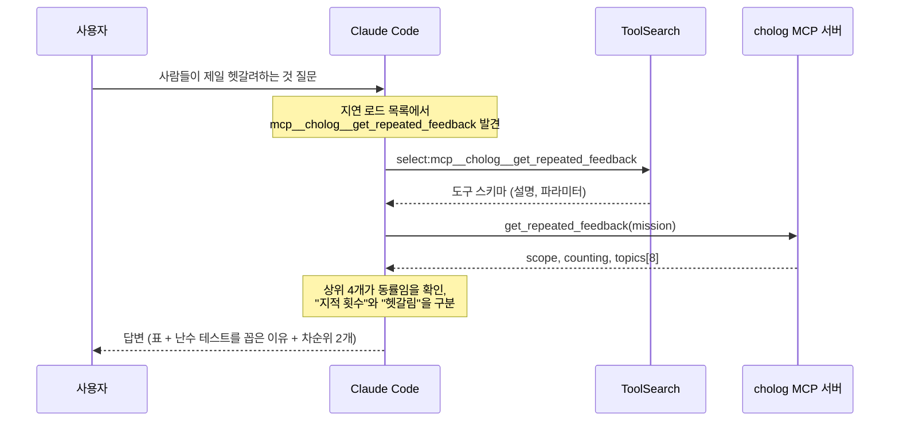
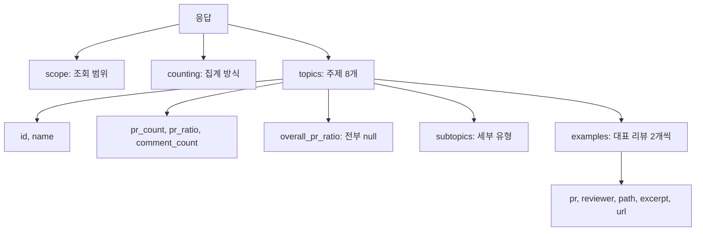
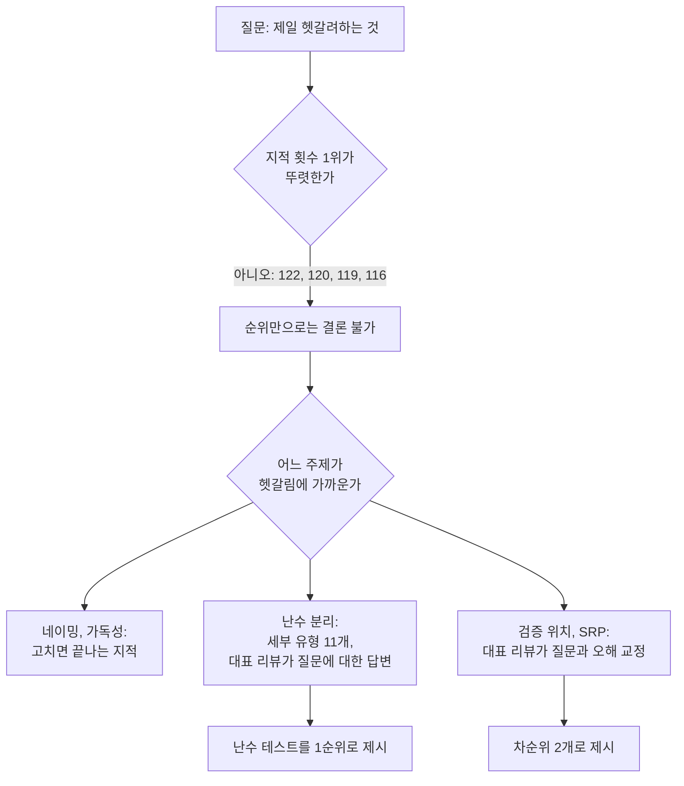

# 자동차 경주 미션에서 가장 헷갈려하는 것: 답변까지의 과정

> 기록 문서다. 맥락 없는 새 Claude Code 세션이 쓴 글을 그대로 옮겼고, GitHub ID만 가렸다. 배경은 [품질 확인](README.md)에 있다.

MCP 도구가 어떤 순서로 쓰였는지, 응답의 어느 필드가 답변의 어느 부분이 됐는지를 정리한 문서입니다.
내부 추론을 그대로 옮긴 것이 아니라, 실제로 일어난 도구 호출과 판단 근거를 요약한 것입니다.

> 질문: 초록스터디 자동차경주에서 사람들이 제일 헷갈려하는게 뭐야?

## 전체 흐름



도구 호출은 총 2번이었습니다. 파일 탐색, 웹 검색, 서브에이전트는 쓰지 않았습니다.

## 1단계: 도구 고르기

세션 시작 시점에 cholog 도구는 **이름만** 알려진 상태였습니다(지연 로드). 스키마가 없어서 바로 호출할 수 없습니다.

도구를 고른 근거는 두 가지입니다.

- 도구 이름: `mcp__cholog__get_repeated_feedback` (반복 피드백 조회)
- cholog 서버 안내문: "초록스터디 미션의 과거 PR과 코드 리뷰 기록을 근거로 답한다. 숫자를 말할 때는 대표 리뷰의 GitHub 링크를 함께 보여주고, 데이터 기준 시각(data_as_of)을 밝힌다."

질문에 "초록스터디"와 "자동차경주"가 그대로 들어 있어서 대상 서버는 분명했습니다.
다만 cholog 서버의 도구는 이것 하나뿐이었고, "헷갈려하는 것"을 직접 재는 도구는 없었습니다. 그래서 "반복해서 지적받은 것"을 대리 지표로 쓰기로 했습니다.

## 2단계: 스키마 불러오기 (ToolSearch)

호출:

```json
{
  "query": "select:mcp__cholog__get_repeated_feedback",
  "max_results": 5
}
```

돌아온 스키마의 핵심:

| 파라미터 | 타입 | 기본값 | 설명 |
|---|---|---|---|
| `mission` | `"java-racingcar"` 고정 | (필수) | 미션 |
| `authors` | 문자열 배열 또는 null | null | PR 작성자 GitHub ID. 없으면 미션 전체 |
| `max_topics` | 정수 1~20 | 8 | 돌려줄 주제 수 |
| `examples_per_topic` | 정수 0~5 | 2 | 주제마다 붙일 대표 리뷰 수 |
| `since` | 날짜 또는 null | null | 이 날짜 이후에 만든 PR만 |

도구 설명에 들어 있던 사용 지침:

- 미션을 시작하기 전에 과거 참가자들이 자주 지적받은 점을 알고 싶을 때는 `authors`를 비운다.
- 숫자는 키워드로 센 값이라 실제보다 적다. 답할 때 대략적인 값임을 밝히고 대표 리뷰 링크를 함께 보여준다.

질문의 주어가 특정 스터디원이 아니라 "사람들"이라 `authors`를 비우는 쪽으로 결정했습니다.

## 3단계: 조회 (get_repeated_feedback)

호출:

```json
{
  "mission": "java-racingcar"
}
```

파라미터를 이렇게 정한 이유:

| 파라미터 | 값 | 이유 |
|---|---|---|
| `mission` | `java-racingcar` | 자동차 경주 미션. 스키마상 허용값이 이것 하나뿐 |
| `authors` | 생략 (null) | 질문이 "사람들" 전체를 물음. 특정 ID가 주어지지 않음 |
| `max_topics` | 생략 (기본 8) | "제일" 하나를 묻는 질문이라 상위권만 있으면 충분 |
| `examples_per_topic` | 생략 (기본 2) | 주제당 링크 한두 개면 답변 근거로 충분 |
| `since` | 생략 | 기간 조건이 질문에 없음 |

필수값 외에는 전부 기본값을 썼습니다.

## 4단계: 응답 구조

응답은 세 덩어리였습니다.



`scope`와 `counting` 원문:

```json
{
  "scope": {
    "mission": "java-racingcar",
    "authors_requested": 0,
    "authors_not_found": [],
    "pr_count": 215,
    "reviewed_pr_count": 173,
    "reviewer_comment_count": 2940,
    "data_as_of": "2026-09-15T15:27:02+09:00"
  },
  "counting": {
    "method": "keyword",
    "untagged_comment_count": 1231,
    "note": "키워드로 센 값이라 실제보다 적게 잡힌다. 주제가 붙지 않은 리뷰가 1231개 있다."
  }
}
```

주제 8개의 수치:

| 순위 | id | 이름 | pr_count | pr_ratio | comment_count | subtopics 수 |
|---|---|---|---|---|---|---|
| 1 | `naming` | 네이밍 | 122 | 0.71 | 322 | 0 |
| 2 | `exception` | 예외 처리 / 검증 | 120 | 0.69 | 349 | 0 |
| 3 | `responsibility` | 책임 분리 / SRP | 119 | 0.69 | 348 | 0 |
| 4 | `testability-random` | 테스트 용이성 (난수 분리) | 116 | 0.67 | 253 | 11 |
| 5 | `readability` | 가독성 | 115 | 0.66 | 255 | 0 |
| 6 | `data-structure` | 자료구조 선택 | 90 | 0.52 | 171 | 0 |
| 7 | `test-writing` | 테스트 작성 / 보강 | 78 | 0.45 | 145 | 0 |
| 8 | `layering` | MVC / 레이어 분리 | 72 | 0.42 | 158 | 0 |

`overall_pr_ratio`는 8개 주제 모두 null이었습니다. `authors`를 비워서 조회 범위 자체가 미션 전체였기 때문으로 보입니다.

`subtopics`는 4위(난수 분리)에만 값이 있었고, 나머지 7개는 빈 배열이었습니다. 난수 분리의 세부 유형 11개:

| id | 이름 | pr_count |
|---|---|---|
| `random-test-only-code` | 테스트를 위해 프로덕션 코드를 추가 | 22 |
| `random-di` | 의존성 주입(DIP)을 제안받음 | 21 |
| `random-new-each-time` | Random 객체를 매번 new | 16 |
| `random-in-name` | random이라는 단어가 이름에 남음 | 11 |
| `random-test-double` | 테스트 대역(Stub, Mock, Fake)을 제안받음 | 11 |
| `random-direct` | 자동차나 진행 객체가 난수를 직접 생성 | 9 |
| `random-luck-test` | 운에 기대는 테스트, 항상 성공하는 테스트 | 9 |
| `random-strategy` | 전략 패턴을 제안받음 | 9 |
| `random-test-itself` | 난수 자체를 테스트하려 함 | 9 |
| `random-inherit` | Random을 상속해서 테스트 | 8 |
| `random-new-inside` | 인터페이스를 만들고 내부에서 new (주입 안 됨) | 2 |

## 5단계: 응답을 답변으로 바꾸기



| 답변의 부분 | 근거가 된 필드 | 가공 방식 |
|---|---|---|
| "리뷰가 달린 PR 173개 기준" | `scope.reviewed_pr_count` | 그대로 옮김 |
| "상위 4개 주제가 거의 동률" | 1~4위 `pr_count` (122, 120, 119, 116) | 차이가 6건 이내임을 확인 |
| 데이터 기준 시각 | `scope.data_as_of` | 그대로 옮김 (서버 안내문 요구 사항) |
| "실제보다 적게 잡힘", "1231개 미분류" | `counting.note`, `untagged_comment_count` | 그대로 옮김 (도구 설명 요구 사항) |
| 표의 "약 122개" | `pr_count` | "약"을 붙임 (키워드 집계라 대략적인 값) |
| 표의 "비율" | `pr_ratio` | 백분율로 변환 |
| 난수 세부 유형 7개 | `subtopics` | 11개 중 7개를 골라 옮김 |
| 대표 리뷰 링크 6개 | `examples[].url` | 주제당 2개 중 내용이 맞는 것을 링크 |
| "난수 테스트가 헷갈림에 가장 가깝다" | (응답에 없음) | 제 판단 |
| "검증 위치", "SRP 오해"를 차순위로 | `examples[].excerpt` | 발췌문을 읽고 내린 판단 |
| 마지막 줄의 후속 제안 | 스키마의 `authors`, `since` | 가능한 추가 조회를 안내 |

답변에서 뺀 것:

- `comment_count`: 표에 넣지 않았습니다. 코멘트 수 기준이면 순위가 예외 처리(349), 책임 분리(348), 네이밍(322) 순으로 바뀝니다.
- 난수 세부 유형 4개: `random-in-name`(11), `random-direct`(9), `random-strategy`(9), `random-new-inside`(2)는 답변에 넣지 않았습니다.
- 가독성, 자료구조, 테스트 작성, 레이어 분리 주제의 대표 리뷰 링크: 표에 순위만 싣고 링크는 달지 않았습니다.

## 해석이 섞인 부분 (확인 필요)

응답에 명시되지 않았는데 제가 해석해서 쓴 부분입니다.

1. **"지적받은 횟수"를 "헷갈림"의 대리 지표로 썼습니다.** 도구는 리뷰어가 반복해서 지적한 주제를 셀 뿐, 참가자가 무엇을 헷갈렸는지는 재지 않습니다. 답변 첫머리에 이 한계를 밝혔습니다.
2. **4위인 난수 분리를 1순위로 꼽았습니다.** PR 수 기준 1위는 네이밍입니다. 난수를 고른 것은 순위가 아니라 "세부 유형이 여러 갈래"이고 "대표 리뷰가 참가자 질문에 대한 답변 형태"라는 점을 근거로 한 제 판단입니다.
3. **이 판단에는 편향이 있습니다.** `subtopics`는 난수 분리 주제에만 채워져 있습니다. 즉 "시행착오가 여러 갈래"라는 근거는 난수 주제만 세부 분류가 되어 있어서 그렇게 보이는 것일 수 있습니다. 다른 주제도 세부 분류가 있었다면 결론이 달라질 수 있습니다.
4. **차순위 2개는 표본이 작습니다.** "검증 위치"와 "SRP 오해"는 주제당 대표 리뷰 2개의 발췌문만 보고 골랐습니다. 예외 처리 120개 PR, 책임 분리 119개 PR 전체가 이 내용이라는 뜻은 아닙니다.
5. **`pr_ratio`의 분모.** 122건이 0.71, 116건이 0.67로 나와서 분모를 `reviewed_pr_count`(173)로 봤습니다. `pr_count`(215)가 분모였다면 0.57, 0.54여야 하므로 이 해석은 수치와 맞습니다.
6. **"네이밍, 가독성은 고치면 되는 지적".** 대표 리뷰를 읽고 내린 일반화입니다. 네이밍 대표 리뷰 중 PR #88 것은 참가자가 "메서드 이름은 몇 단어까지가 적절한가"를 물은 데 대한 답변이라, 네이밍에도 헷갈림 성격의 리뷰가 있습니다.

## 하지 않은 것

- GitHub 원문 페이지를 직접 열어 보지 않았습니다. 인용과 링크는 모두 MCP 응답에 들어 있던 것입니다.
- 미분류 코멘트 1231개(전체 2940개의 약 42%)의 내용은 확인하지 않았습니다.
- 참가자가 PR 본문이나 코멘트에 남긴 질문은 조회하지 않았습니다. "헷갈림"을 직접 보려면 리뷰어 코멘트가 아니라 참가자 쪽 질문이 필요한데, 이를 주는 도구가 없었습니다.
- `max_topics`를 늘려 9위 이하 주제를 보지 않았습니다. 이전 조회(`racingcar-feedback-process.md`)에서 나온 "인터페이스 / 추상화", "원시값 포장 / 일급 컬렉션", "접근 제어자"는 이번 응답에 들어 있지 않았습니다.
- 기수별, 기간별(`since`)로 나눠 보지 않았습니다.

## 이전 조회와의 차이

같은 도구를 쓴 `racingcar-feedback-process.md`와 비교한 표입니다.

| 항목 | 이전 (스터디원 공통 지적) | 이번 (가장 헷갈려하는 것) |
|---|---|---|
| `authors` | 10명 지정 | 생략 (미션 전체) |
| `max_topics` | 10 | 8 (기본값) |
| `examples_per_topic` | 3 | 2 (기본값) |
| 리뷰 달린 PR | 10개 | 173개 |
| 리뷰어 코멘트 | 246개 | 2940개 |
| 미분류 코멘트 | 117개 | 1231개 |
| `overall_pr_ratio` | 값 있음 (전체와 비교 가능) | 전부 null |
| PR 수 1위 | 난수 분리 (8/10) | 네이밍 (122/173) |
| 답변의 성격 | 응답 순위를 그대로 정리 | 순위에 해석을 얹어 4위를 선택 |
