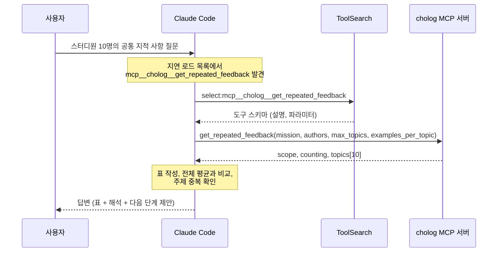
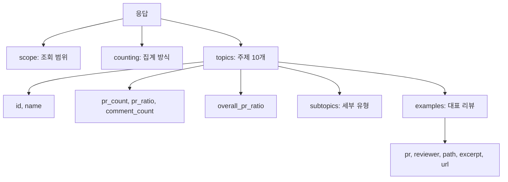

# 자동차 경주 미션 공통 피드백: 답변까지의 과정

> 기록 문서다. 맥락 없는 새 Claude Code 세션이 쓴 글을 그대로 옮겼고, GitHub ID만 가렸다. 배경은 [품질 확인](README.md)에 있다.

MCP 도구가 어떤 순서로 쓰였는지, 응답의 어느 필드가 답변의 어느 부분이 됐는지를 정리한 문서입니다.
내부 추론을 그대로 옮긴 것이 아니라, 실제로 일어난 도구 호출과 판단 근거를 요약한 것입니다.

## 전체 흐름



도구 호출은 총 2번이었습니다. 파일 탐색, 웹 검색, 서브에이전트는 쓰지 않았습니다.

## 1단계: 도구 고르기

세션 시작 시점에 cholog 도구는 **이름만** 알려진 상태였습니다(지연 로드). 스키마가 없어서 바로 호출할 수 없습니다.

도구를 고른 근거는 두 가지입니다.

- 도구 이름: `mcp__cholog__get_repeated_feedback` (반복 피드백 조회)
- cholog 서버 안내문: "초록스터디 미션의 과거 PR과 코드 리뷰 기록을 근거로 답한다. 숫자를 말할 때는 대표 리뷰의 GitHub 링크를 함께 보여주고, 데이터 기준 시각(data_as_of)을 밝힌다."

질문이 "스터디원들이 공통으로 지적받은 것"이라 이름과 안내문만으로 대상이 분명했습니다.

## 2단계: 스키마 불러오기 (ToolSearch)

호출:

```json
{
  "query": "select:mcp__cholog__get_repeated_feedback",
  "max_results": 5
}
```

돌아온 스키마의 핵심:

| 파라미터 | 타입 | 기본값 | 설명 |
|---|---|---|---|
| `mission` | `"java-racingcar"` 고정 | (필수) | 미션 |
| `authors` | 문자열 배열 또는 null | null | PR 작성자 GitHub ID. 없으면 미션 전체 |
| `max_topics` | 정수 1~20 | 8 | 돌려줄 주제 수 |
| `examples_per_topic` | 정수 0~5 | 2 | 주제마다 붙일 대표 리뷰 수 |
| `since` | 날짜 또는 null | null | 이 날짜 이후에 만든 PR만 |

도구 설명에 들어 있던 사용 지침:

- 미션이 끝난 뒤 스터디원 공통 리뷰를 정리할 때는 `authors`에 GitHub ID를 넣는다.
- 숫자는 키워드로 센 값이라 실제보다 적다. 답할 때 대략적인 값임을 밝히고 대표 리뷰 링크를 함께 보여준다.

이 설명이 질문 상황("미션이 끝난 뒤", "스터디원")과 그대로 맞아서 `authors`를 채우는 쪽으로 결정했습니다.

## 3단계: 조회 (get_repeated_feedback)

호출:

```json
{
  "mission": "java-racingcar",
  "authors": [
    "learner-09", "learner-06", "learner-07", "learner-10", "learner-01",
    "learner-08", "learner-04", "learner-02", "learner-05", "learner-03"
  ],
  "max_topics": 10,
  "examples_per_topic": 3
}
```

파라미터를 이렇게 정한 이유:

| 파라미터 | 값 | 이유 |
|---|---|---|
| `mission` | `java-racingcar` | 자동차 경주 미션. 스키마상 허용값이 이것 하나뿐 |
| `authors` | 10명 전부 | 질문에 적힌 ID를 그대로 전달 |
| `max_topics` | 10 (기본 8) | 수업 자료용이라 주제 후보를 조금 넓게 확보 |
| `examples_per_topic` | 3 (기본 2) | 수업에서 인용할 대표 리뷰를 여유 있게 확보 |
| `since` | 생략 | 기간 조건이 질문에 없음 |

`max_topics`와 `examples_per_topic`은 사용자가 지정한 값이 아니라 제가 고른 값입니다.

## 4단계: 응답 구조

응답은 세 덩어리였습니다.



`scope`와 `counting` 원문:

```json
{
  "scope": {
    "mission": "java-racingcar",
    "authors_requested": 10,
    "authors_not_found": [],
    "pr_count": 11,
    "reviewed_pr_count": 10,
    "reviewer_comment_count": 246,
    "data_as_of": "2026-09-15T15:27:02+09:00"
  },
  "counting": {
    "method": "keyword",
    "untagged_comment_count": 117,
    "note": "키워드로 센 값이라 실제보다 적게 잡힌다. 주제가 붙지 않은 리뷰가 117개 있다."
  }
}
```

주제 하나의 모양(1위, 대표 리뷰는 1개만 남기고 발췌문은 줄임):

```json
{
  "id": "testability-random",
  "name": "테스트 용이성 (난수 분리)",
  "pr_count": 8,
  "pr_ratio": 0.8,
  "comment_count": 25,
  "overall_pr_ratio": 0.67,
  "subtopics": [
    { "id": "random-test-itself", "name": "난수 자체를 테스트하려 함", "pr_count": 3 },
    { "id": "random-in-name", "name": "random이라는 단어가 이름에 남음", "pr_count": 2 },
    { "id": "random-luck-test", "name": "운에 기대는 테스트, 항상 성공하는 테스트", "pr_count": 2 },
    { "id": "random-test-double", "name": "테스트 대역(Stub, Mock, Fake)을 제안받음", "pr_count": 2 },
    { "id": "random-test-only-code", "name": "테스트를 위해 프로덕션 코드를 추가", "pr_count": 2 }
  ],
  "examples": [
    {
      "pr": 189,
      "reviewer": "reviewer-id",
      "path": "src/main/java/domain/VehicleRace.java",
      "excerpt": "만약 랜덤을 밖에서 관리하고 그 값을 인자로 받는다면, 테스트를 작성할 수 있지 않을까요? ...",
      "url": "https://github.com/next-step/java-racingcar-simple-playground/pull/189#discussion_r3004241535"
    }
  ]
}
```

`subtopics`는 10개 주제 중 1위(난수 분리)에만 값이 있었고, 나머지 9개는 빈 배열이었습니다.

## 5단계: 응답을 답변으로 바꾸기

| 답변의 부분 | 근거가 된 필드 | 가공 방식 |
|---|---|---|
| 데이터 기준 시각 | `scope.data_as_of` | 그대로 옮김 (서버 안내문 요구 사항) |
| "10명 모두 조회됨" | `authors_requested: 10`, `authors_not_found: []` | 못 찾은 ID가 없음을 확인 |
| "PR 11개 중 리뷰 달린 10개" | `pr_count`, `reviewed_pr_count` | 그대로 옮김 |
| "대략적인 값", "117개 미분류" | `counting.note`, `untagged_comment_count` | 그대로 옮김 (도구 설명 요구 사항) |
| 표의 "8/10" | `pr_count: 8`, `pr_ratio: 0.8` | 분모를 `reviewed_pr_count`(10)로 해석 |
| 표의 "코멘트 수" | `comment_count` | 그대로 옮김 |
| 표의 "미션 전체 비율" | `overall_pr_ratio` | 백분율로 변환 |
| 표의 "대표 리뷰" | `examples[].url` | 주제당 3개 중 수업에 쓰기 좋은 것 1개를 골라 링크 |
| 난수 분리 세부 유형 | `subtopics` | 그대로 옮김 |
| "전체 평균보다 많이 지적" | `pr_ratio` 대 `overall_pr_ratio` | 차이가 큰 주제 3개를 골라냄 |
| "예외 처리는 코멘트가 가장 많음" | `comment_count: 28` | 10개 주제의 코멘트 수를 비교 |
| "주제끼리 겹침" | `examples[].url` | 같은 URL이 두 주제에 나온 것을 확인 |
| 수업 목차 4묶음 | (응답에 없음) | 제 제안 |

주제 중복으로 확인한 사례는 두 건입니다.

- `discussion_r3003543465` (PR #192): 가독성, 자료구조 선택 양쪽에 등장
- `discussion_r2999312011` (PR #183): 자료구조 선택, 원시값 포장 양쪽에 등장

## 해석이 섞인 부분 (확인 필요)

응답에 명시되지 않았는데 제가 해석해서 쓴 부분입니다. 답변에서는 단정적으로 썼지만 엄밀히는 추정입니다.

1. **`overall_pr_ratio`의 의미.** 응답에 필드 설명이 없습니다. 필드 이름과 도구 설명("authors를 비우면 미션 전체")을 근거로 "미션 전체 참가자 기준 비율"이라고 해석했습니다.
2. **`pr_ratio`의 분모.** 8건이 0.8로 나와서 분모를 `reviewed_pr_count`(10)로 봤습니다. `pr_count`(11)가 분모였다면 0.73이어야 하므로 이 해석은 수치와 맞습니다.
3. **"난수 분리, 추상화, 테스트 작성은 한 흐름".** 대표 리뷰 발췌문을 읽고 내린 판단입니다. 예를 들어 추상화 주제의 대표 리뷰 중 PR #192 것은 내용상 난수 테스트 이야기였습니다. 다만 주제당 3개씩만 본 것이라 전체 코멘트로 검증한 것은 아닙니다.
4. **수업 목차 4묶음.** 데이터가 준 것이 아니라 제가 제안한 분류입니다.

## 하지 않은 것

- GitHub 원문 페이지를 직접 열어 보지 않았습니다. 인용과 링크는 모두 MCP 응답에 들어 있던 것입니다.
- 스터디원별로 누가 무엇을 지적받았는지는 분류하지 않았습니다. 응답은 PR 번호와 리뷰어만 주고 PR 작성자는 주지 않습니다.
- 미분류 코멘트 117개의 내용은 확인하지 않았습니다.
