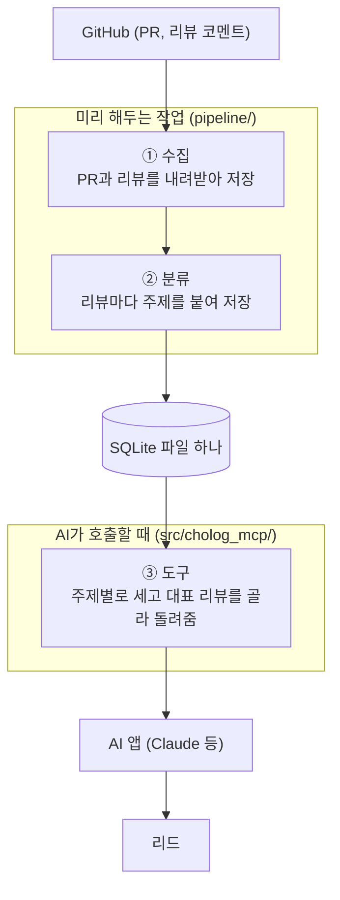
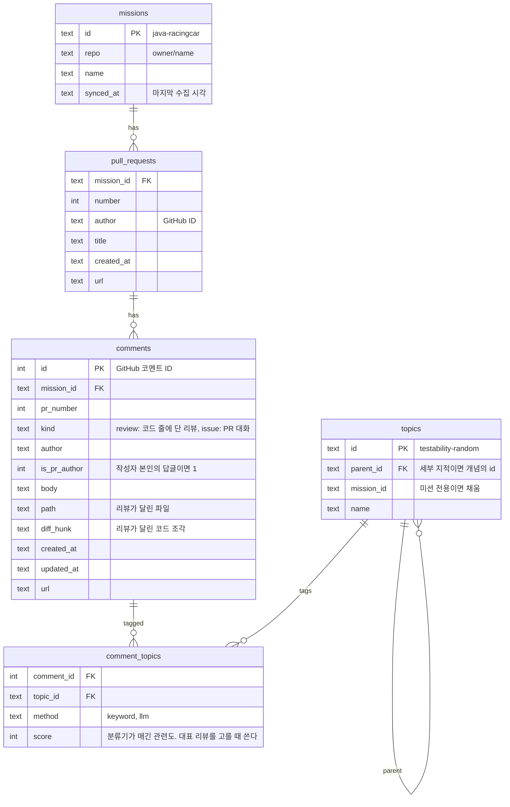
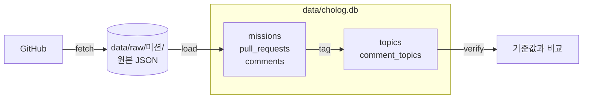

# 도구 명세

- 상태: 초안 (2026-10-07). 첫 도구 1개는 상세히, 나머지는 이름과 한 줄만 적는다.
- 구현하면서 바뀌는 내용은 이 문서를 먼저 고친다.

## 1. 무엇을 만드는가

초록스터디 리드가 AI에게 아래처럼 물으면, 과거 PR의 리뷰 기록을 근거로 답하게 한다.

> "자동차 경주 미션에서 리뷰어들이 반복해서 지적한 게 뭐야? 우리 스터디원은 이 10명이야."

리드는 이 답을 두 군데에 쓴다.

| 쓰는 때 | 보는 범위 | 만드는 것 |
|---|---|---|
| 미션이 끝나고 다음 스터디 전 | 우리 스터디원들의 PR | "이전 미션 리뷰" 수업 자료 |
| 다음 미션을 안내하기 전 | 그 미션의 과거 PR 전체 | 사전 안내 (미리 짚어줄 것) |

둘은 범위만 다르고 하는 일은 같다. 그래서 도구 하나에 범위를 입력으로 받는다.

### 이 도구가 지켜야 할 것

리드가 AI에게 리뷰를 통째로 읽혀 봤을 때 부족했던 점에서 나온 요구사항이다.

| 부족했던 점 | 요구사항 |
|---|---|
| 리뷰를 전부 읽히면 토큰이 많이 든다 | 전부가 아니라 집계와 대표 리뷰 몇 개만 돌려준다 |
| AI의 요약만으로는 못 믿고 직접 확인하고 싶다 | 모든 리뷰에 GitHub 원문 링크를 붙인다 |
| 스터디 직전까지 리뷰가 달려서 빠지는 내용이 생긴다 | 답에 "언제 기준 데이터인지"를 밝힌다 |

## 2. 전체 흐름

일은 세 덩어리로 나뉜다. 앞의 둘은 미리 해두는 작업이고, 마지막 하나만 AI가 호출한다.



각 단계가 실제로 무엇을 읽고 쓰는지는 5번 파이프라인에 있다.

### 왜 ②분류와 ③도구를 나누는가

"반복 지적한 것"을 세려면 먼저 리뷰 하나하나가 **무슨 주제에 대한 지적인지** 알아야 한다. 이게 ②분류다. 그 다음에야 주제별로 셀 수 있다. 이게 ③도구다.

Spring으로 비유하면 이렇다.

- ②분류는 **배치 작업**이다. 리뷰를 읽고 `comment_topics`라는 테이블에 "이 리뷰는 이 주제"라는 행을 채워 넣는다.
- ③도구는 **조회 API**다. `comment_topics` 테이블을 `GROUP BY`로 세서 돌려줄 뿐, 리뷰가 어떤 방법으로 분류됐는지는 모른다.

이렇게 나누면 분류 방법을 바꿔도 도구 코드는 그대로다. 이 점이 중요한 이유는 **분류가 이 프로젝트에서 가장 어렵고, 계속 개선할 부분**이기 때문이다.

### 분류 방법: 지금은 키워드, 나중에 개선

| 방법 | 설명 | 상태 |
|---|---|---|
| 키워드 사전 | "책임", "매직넘버" 같은 단어가 리뷰에 있으면 그 주제로 본다 | **지금 쓰는 방법** |
| AI 분류 | AI가 리뷰를 읽고 주제를 붙인다 | 확장 과제 |

키워드 방식의 한계는 이미 측정했다.

- 자동차 경주 미션의 리뷰어 코멘트 2,940개 중 1,231개(42%)는 어떤 주제에도 걸리지 않는다. 같은 지적도 비유, 질문, 예시 코드 등 여러 방식으로 표현되기 때문이다.
- 그래서 키워드로 센 숫자는 **실제보다 적게 잡힌 값(하한값)**이다. 도구는 답에 이 사실을 함께 돌려준다.

그래도 키워드로 시작하는 이유: 지금 바로 되고, 비용이 없고, 같은 입력에 항상 같은 결과가 나온다. 도구를 끝까지 만들어 본 뒤에 분류를 개선해도 도구를 다시 만들 필요가 없다.

### 주제는 2단계

| 단계 | 예 | 범위 |
|---|---|---|
| 개념 | 책임 분리, 테스트 용이성, 예외 처리, 네이밍 | 모든 미션 공통. 지금 20개 |
| 세부 지적 | "인터페이스를 만들고도 내부에서 `new` 해서 주입이 안 됨" | 미션마다 다름. 지금은 자동차 경주의 난수 관련 11개만 |

세부 지적이 붙은 리뷰에는 그 위의 개념도 함께 붙인다. 그래서 세부 지적의 수는 개념의 수를 넘지 않는다.

개념만으로는 "책임 분리를 많이 지적받는다" 수준이라 리드가 이미 아는 이야기다. 리드에게 쓸모 있는 답은 세부 지적에서 나온다. 세부 지적을 미션마다 찾아 채우는 것이 미션 확장의 핵심 과제다.

## 3. 첫 도구: `get_repeated_feedback`

미션에서 리뷰어들이 반복 지적한 주제를 많은 순으로 돌려준다. 주제마다 대표 리뷰를 원문 링크와 함께 붙인다.

### 입력

| 이름 | 타입 | 필수 | 설명 |
|---|---|---|---|
| `mission` | `Literal["java-racingcar"]` | O | 미션. 지원하는 미션만 받는다. 미션이 늘면 값이 늘어난다 |
| `authors` | `list[str]` | X | PR 작성자의 GitHub ID 목록. 주면 이 사람들의 PR만 본다 (우리 스터디). 없으면 전체. 대소문자는 구분하지 않고, 앞의 `@`는 뗀다 |
| `since` | `str` (YYYY-MM-DD) | X | 이 날짜 이후에 만든 PR만 본다. 같은 사람이 미션을 다시 한 경우를 거를 때 쓴다 |
| `max_topics` | `int` (1~20, 기본 8) | X | 돌려줄 주제 수 |
| `examples_per_topic` | `int` (0~5, 기본 2) | X | 주제마다 붙일 대표 리뷰 수 |

스터디 구분은 GitHub ID 목록으로 한다. PR 제목의 `[스터디명]` 접두사는 붙이지 않은 PR이 많아 믿을 수 없다. 서버가 스터디 명단을 저장하지 않으므로 질문하는 쪽이 목록을 넘긴다.

### 출력

```json
{
  "scope": {
    "mission": "java-racingcar",
    "authors_requested": 10,
    "authors_not_found": ["tpyo-id"],
    "pr_count": 11,
    "reviewed_pr_count": 10,
    "reviewer_comment_count": 246,
    "data_as_of": "2026-10-07T01:00:00+09:00"
  },
  "counting": {
    "method": "keyword",
    "untagged_comment_count": 117,
    "note": "키워드로 센 값이라 실제보다 적게 잡힌다. 주제가 붙지 않은 리뷰가 117개 있다."
  },
  "topics": [
    {
      "id": "testability-random",
      "name": "테스트 용이성 (난수 분리)",
      "pr_count": 8,
      "pr_ratio": 0.8,
      "comment_count": 24,
      "overall_pr_ratio": 0.61,
      "subtopics": [
        {"id": "random-new-inside", "name": "인터페이스를 만들고 내부에서 new", "pr_count": 3}
      ],
      "examples": [
        {
          "pr": 190,
          "author": "learner-id",
          "reviewer": "reviewer-id",
          "path": "src/main/java/Car.java",
          "excerpt": "리뷰 본문 앞부분 (최대 300자)",
          "url": "https://github.com/next-step/java-racingcar-simple-playground/pull/190#discussion_r0000000000"
        }
      ]
    }
  ]
}
```

위 값은 형태를 보여주기 위한 예시다.

| 필드 | 뜻 |
|---|---|
| `scope.authors_not_found` | 넘긴 ID 중 PR이 없는 ID. 오타를 알아채게 한다 |
| `scope.reviewed_pr_count` | 리뷰어 코멘트가 하나라도 달린 PR 수. 비율의 분모다 |
| `scope.data_as_of` | 마지막으로 수집한 시각. 그 뒤에 달린 리뷰는 빠져 있다 |
| `counting` | 세는 방법과 그 한계. AI가 숫자를 단정적으로 말하지 않게 한다 |
| `topics[].pr_count`, `pr_ratio` | 이 주제를 지적받은 PR 수와 비율 |
| `topics[].overall_pr_ratio` | 같은 미션 전체에서의 비율. `authors`를 줬을 때만 채운다. "우리만 이런가, 원래 다들 이런가"를 보게 한다 |
| `topics[].subtopics` | 세부 지적. 채워진 주제에만 있다 |
| `topics[].examples` | 대표 리뷰. `author`는 리뷰를 받은 PR 작성자, `reviewer`는 리뷰를 쓴 사람이다. 본문은 앞부분만 자르고 전체는 `url`로 확인한다 |

### 규칙

- **리뷰어의 코멘트만 센다.** PR 작성자 본인이 단 답글은 세지 않는다 (전체 코멘트의 약 40%가 작성자 답글이다).
- **정렬은 `pr_count` 내림차순.** 한 PR에서 같은 지적을 여러 번 받아도 한 번으로 친다. 같으면 `comment_count`가 많은 순.
- **대표 리뷰 고르기**: 서로 다른 PR에서 하나씩, `score`가 큰 순으로 고른다. 너무 짧은 것(30자 미만)은 뺀다. 여러 주제의 대표 리뷰가 몇몇 PR에 몰리지 않도록, 앞선 주제에서 아직 쓰지 않은 PR을 먼저 고르고 모자라면 이미 쓴 PR에서 고른다. 더 나은 기준은 개선 과제다.
- **대표 리뷰 본문 자르기**: 리뷰어가 인용한 줄(`>`)은 빼고, 빈 줄과 이어진 공백은 하나로 줄인 뒤 앞에서 300자를 자른다. 잘렸으면 끝에 `…`를 붙인다.
- **돌려주는 양을 제한한다.** 기본값 기준 주제 8개에 리뷰 16개, 리뷰 본문 합계 4,800자 이내다. 링크와 필드 이름까지 합친 응답 전체는 자동차 경주 미션에서 약 12,800자였다 (측정값).
- **조건에 맞는 PR이 없으면** 에러가 아니라 `pr_count: 0`과 빈 `topics`를 돌려준다. 이유는 `authors_not_found`로 알 수 있다.

### 도구 설명 (docstring)

도구 설명은 AI와 사용자가 읽는 설명서다. 언제 쓰는지와 무엇을 돌려주는지를 적는다. 응답에는 필드 설명이 따로 붙지 않으므로, AI가 뜻을 추측해야 하는 필드는 여기서 풀어 준다.

```
미션에서 리뷰어들이 반복해서 지적한 주제를 많은 순으로 돌려준다.
주제마다 지적받은 PR 수와 대표 리뷰(GitHub 원문 링크 포함)가 붙는다.

이럴 때 쓴다:
- 미션이 끝난 뒤 스터디원들이 공통으로 받은 리뷰를 정리할 때 (authors에 스터디원 GitHub ID를 넣는다)
- 미션을 시작하기 전에 과거 참가자들이 자주 지적받은 점을 알고 싶을 때 (authors를 비운다)

숫자는 키워드로 센 값이라 실제보다 적다. 답할 때 대략적인 값임을 밝히고, 대표 리뷰의 링크를 함께 보여준다.

돌려주는 값 읽는 법:
- pr_count, pr_ratio: 이 주제를 지적받은 PR 수와 비율. 비율의 분모는 리뷰어 코멘트가 달린 PR 수(scope.reviewed_pr_count)다.
- overall_pr_ratio: 같은 미션의 과거 참가자 전체에서 이 주제를 지적받은 PR 비율. authors를 줬을 때만 채워진다.
  pr_ratio가 이 값보다 크면 이 스터디가 유독 많이 지적받은 주제다.
- subtopics: 주제 안의 세부 지적. 아직 일부 주제에만 있다.
- examples: 대표 리뷰. author는 리뷰를 받은 PR 작성자, reviewer는 리뷰를 쓴 사람이다. excerpt는 앞부분만 자른 것이다.
```

## 4. 데이터 구조

SQLite 파일 하나에 둔다. 파일 경로는 환경 변수 `CHOLOG_DB_PATH`로 받는다 (기본값 `data/cholog.db`).



- `comments.is_pr_author`는 수집할 때 계산해 둔다. 조회할 때마다 PR 작성자와 비교하지 않기 위해서다.
- `comment_topics.method`에 분류 방법을 남긴다. 분류 방법을 바꾸거나 둘을 비교할 때 쓴다.
- `comment_topics.score`는 그 리뷰가 주제와 얼마나 관련 있는지다. 키워드 방식에서는 키워드가 걸린 횟수다. 도구는 이 값이 큰 리뷰를 대표로 고른다.
- `updated_at`을 저장해 두면 다음 수집 때 바뀐 것만 다시 받을 수 있다.

## 5. 파이프라인

위 테이블을 채우는 일이다. 서버는 DB를 읽기만 하고, 쓰는 것은 전부 파이프라인이 한다. 코드는 `pipeline/`에 있고, 사람이 명령으로 직접 돌린다.



| 명령 | 하는 일 | 읽는 것 | 쓰는 것 | 코드 |
|---|---|---|---|---|
| `fetch` | GitHub에서 PR 목록과 코멘트를 받는다 | GitHub API | `data/raw/<미션>/` | `fetch.py` |
| `load` | 원본을 테이블에 넣는다 | `data/raw/<미션>/` | `missions`, `pull_requests`, `comments` | `load.py` |
| `tag` | 리뷰어 코멘트에 주제를 붙인다 | `comments` | `topics`, `comment_topics` | `tagger.py`, `topics.py` |
| `verify` | 결과를 기준값과 비교한다 | 테이블 전체 | 없음 (화면에 출력) | `verify.py` |

모두 `uv run python -m pipeline <명령> <미션>` 형태로 돌린다. 예: `uv run python -m pipeline tag java-racingcar`

수집(`fetch`)과 적재(`load`)를 나눈 이유: 원본을 파일로 남겨 두면, 테이블 구조를 바꿨을 때 GitHub를 다시 부르지 않고 `load`만 다시 돌리면 된다.

### fetch: 수집

GitHub CLI(`gh`)로 받는다. 먼저 `gh auth login`으로 로그인해 둔다.

| 받는 것 | 저장 위치 | API 호출 |
|---|---|---|
| PR 목록 (번호, 작성자, 제목, 만든 시각) | `prs.json` | 1번 |
| 코드 줄에 단 리뷰 | `review/<PR 번호>.json` | PR마다 1번 |
| PR 대화에 단 코멘트 | `issue/<PR 번호>.json` | PR마다 1번 |
| 수집을 시작한 시각 | `meta.json` | |

- PR이 200개면 약 400번 부른다. 받을 때마다 전부 다시 받는다.
- `--only 190 191`처럼 PR 번호를 주면 그 PR의 코멘트만 받는다. 시험해 볼 때 쓴다.
- 받지 않는 것: PR 본문, 리뷰를 제출할 때 쓰는 총평, 코드 자체.

### load: 적재

- **미션 단위로 통째로 바꾼다.** 그 미션의 PR, 코멘트, 주제 연결을 지우고 원본으로 다시 넣는다. 하나의 트랜잭션이라 중간에 실패하면 이전 상태가 남는다.
- 주제 연결(`comment_topics`)도 함께 지워지므로 `load` 뒤에는 `tag`를 꼭 돌린다.
- 넣으면서 계산하는 값:
  - `comments.is_pr_author`: 코멘트를 쓴 사람이 그 PR의 작성자면 1
  - `pull_requests.url`: 저장소 이름과 PR 번호로 만든다
  - `missions.synced_at`: `meta.json`의 수집 시각. 도구가 `data_as_of`로 돌려주는 값이다

### tag: 분류

리뷰어 코멘트(`is_pr_author = 0`)만 대상으로 한다. 주제 사전은 `topics.py`에, 붙이는 방법은 `tagger.py`에 있다.

**개념 붙이기**

1. 본문에서 키워드와 상관없는 부분을 지운다: 코드 블록, 인라인 코드, 인용한 줄(`>`), 링크, 이미지.
2. 소문자로 바꾼다.
3. 개념마다 키워드가 몇 번 나오는지 센다. 한 번이라도 나오면 그 개념을 붙이고, 나온 횟수가 `score`가 된다.

**세부 지적 붙이기** (미션 전용)

1. 관문(gate) 정규식에 걸리는지 본다. 자동차 경주에서는 난수에 관한 리뷰인지 확인한다.
2. 걸렸으면 세부 지적마다 정해 둔 정규식을 대 본다. 걸린 횟수가 `score`가 된다.
3. 세부 지적이 붙으면 그 위의 개념도 함께 붙인다.

세부 지적은 본문을 지우지 않고 원문 그대로 본다. 이 방식으로 손으로 분석한 숫자가 그대로 나오는 것을 확인했기 때문이다.

**예시**

```
> 랜덤 값은 어떻게 테스트하나요?

`Random`을 상속해서 테스트하셨네요. 난수 생성의 책임을 밖으로 빼면 어떨까요? 책임이 나뉘면 테스트도 쉬워져요.
```

| 붙는 주제 | score | 이유 |
|---|---|---|
| `responsibility` (책임 분리) | 2 | "책임"이 2번 나온다 |
| `random-inherit` (Random을 상속해서 테스트) | 1 | 난수에 관한 리뷰이고 "상속"이 나온다 |
| `testability-random` (테스트 용이성) | 1 | 세부 지적이 붙어서 함께 붙는다 |

인용한 줄의 "랜덤"과 인라인 코드의 `Random`은 지워져서 개념의 키워드로 세지 않는다. 그래서 `testability-random`은 키워드가 아니라 세부 지적 때문에 붙었다.

반대로 "이 부분 다시 한번 고민해 보면 좋겠어요!" 같은 코멘트는 아무 주제도 붙지 않는다. 주제가 붙지 않는 리뷰어 코멘트가 42%인 이유다.

**다시 돌릴 때**: 그 미션의 키워드 분류 결과만 지우고 다시 붙인다. 몇 번을 돌려도 결과가 쌓이지 않는다.

### verify: 확인

적재와 분류 결과를 기준값(8-1, 8-2)과 비교해 표로 보여 준다. 기준값은 `verify.py`의 `EXPECTED`에 있다.

- 주제 사전을 고쳤으면 `tag` 뒤에 `verify`를 돌려, 고치려던 숫자만 바뀌었는지 본다.
- 데이터를 새로 수집하면 PR과 코멘트가 늘어 기준값과 달라진다. 달라진 이유를 확인하고 기준값을 고친다.

### 언제 무엇을 다시 돌리나

| 상황 | 돌릴 명령 |
|---|---|
| 새 PR이나 리뷰가 달렸다 | `fetch` → `load` → `tag` |
| 테이블 구조를 바꿨다 | `load` → `tag` |
| 주제 사전을 고쳤다 (키워드, 세부 지적) | `tag` → `verify` |
| 분류 방법을 바꿨다 | `tag` → `verify` |

### 미션을 추가하려면

1. `src/cholog_mcp/missions.py`의 `MissionId`와 `MISSIONS`에 미션을 더한다.
2. `fetch` → `load` → `tag`를 돌린다. 개념 20개는 모든 미션에 공통이라 바로 붙는다.
3. 그 미션의 리뷰를 읽고 세부 지적을 찾아 `pipeline/topics.py`의 `SUBTOPICS`에 더한다.
4. 손으로 확인한 숫자를 `pipeline/verify.py`의 `EXPECTED`에 기준값으로 적는다.

### 지금의 한계

- 자동으로 돌지 않는다. 사람이 명령을 돌려야 데이터가 갱신된다.
- 바뀐 것만 받지 못하고 매번 전부 다시 받는다.
- 키워드에 걸리지 않는 리뷰는 세지 못한다.

앞의 둘은 9번의 "데이터를 언제, 어떻게 갱신할까"에서, 마지막은 "AI 분류를 어떻게 할까"에서 다룬다.

## 6. 나머지 도구 (이름과 한 줄)

아직 설계하지 않았다. 설계는 각 도구를 맡은 사람이 한다.

| 이름 (가칭) | 답하는 질문 |
|---|---|
| `get_topic_feedback` | 이 주제의 리뷰를 더 보여줘. `get_repeated_feedback`의 결과에서 한 주제를 파고든다 |
| `get_learner_questions` | 스터디원들이 헷갈려하거나 궁금해한 것은? PR 작성자의 답글과 PR 본문을 본다 |
| `get_key_concepts` | 이 미션에서 얻어가야 할 핵심 개념은? |
| `search_reviews` | 이 주제에 대해 과거 리뷰어들은 뭐라고 했나? |
| `list_missions` | 어떤 미션을 물어볼 수 있나? |

## 7. 구조 원칙

배포 방식(각자 설치해 쓰는 로컬 실행, 설치 없이 쓰는 웹)이 아직 정해지지 않았다. 어느 쪽이든 되도록 세 가지를 지킨다.

1. **도구 로직과 실행 방식을 나눈다.** 도구 함수는 DB를 조회해 결과를 만드는 일만 한다. MCP 서버를 띄우는 코드(stdio, HTTP)는 그 함수를 불러 쓰기만 한다.
2. **데이터는 파일 하나, 경로는 설정으로.** 코드에 경로를 적지 않는다.
3. **핵심 기능은 Tool로만 만든다.** MCP에는 Resource와 Prompt도 있지만 AI 앱마다 보여주는 방식이 달라서, 어디서나 같게 동작하는 Tool만 쓴다.

## 8. 검증 기준

구현이 끝났는지는 아래로 판단한다. 구현하기 전에 이 기준을 먼저 테스트로 옮긴다.

### 8-1. 수집한 데이터를 넣었을 때 (실제 데이터)

`uv run python -m pipeline verify java-racingcar`로 확인한다. 기준값은 구현 전에 자동차 경주 미션을 손으로 분석해 얻은 숫자다 (2026-09-15 수집분).

| 항목 | 기준값 |
|---|---|
| PR | 215개 |
| 코멘트 | 4,855개 (리뷰어 2,940개, PR 작성자 본인 1,915개) |
| 리뷰어 코멘트가 달린 PR | 173개 |
| 리뷰어 | 74명 |
| 원문 링크가 없는 코멘트 | 0개 |

### 8-2. 분류했을 때 (실제 데이터)

같은 명령으로 확인한다. 비율의 분모는 리뷰어 코멘트가 달린 PR 173개다.

| 개념 | 지적받은 PR 비율 |
|---|---|
| 네이밍 | 71% |
| 예외 처리 / 검증 | 69% |
| 책임 분리 / SRP | 69% |
| 가독성 | 66% |
| 테스트 용이성 (난수 분리) | 61% 이상. 키워드만으로는 61%이고, 세부 지적이 붙으면 개념도 붙이는 규칙 때문에 실제로는 67%가 나온다 |
| 자료구조 선택 | 52% |
| 테스트 작성 / 보강 | 45% |
| MVC / 레이어 분리 | 42% |
| 인터페이스 / 추상화 | 40% |
| 매직넘버 / 상수화 | 37% |
| 원시값 포장 / 일급 컬렉션 | 27% |

| 세부 지적 (난수) | 지적받은 PR 수 |
|---|---|
| 테스트를 위해 프로덕션 코드를 추가 | 22개 |
| `Random` 객체를 매번 `new` | 16개 |
| `random`이라는 단어가 이름에 남음 | 11개 |
| 난수 자체를 테스트하려 함 | 9개 |
| 운에 기대는 테스트, 항상 성공하는 테스트 | 9개 |
| `Random`을 상속해서 테스트 | 8개 |

### 8-3. 도구 (작은 가짜 데이터)

`uv run pytest`로 확인한다. 실제 데이터는 저장소에 없으므로 테스트는 직접 만든 작은 데이터를 쓴다.

- PR 작성자 본인의 답글은 세지 않는다.
- 한 PR에서 같은 주제를 여러 번 지적받아도 `pr_count`는 1만 오른다.
- `topics`는 `pr_count` 내림차순이고, 같으면 `comment_count` 내림차순이다.
- `pr_ratio`의 분모는 `reviewed_pr_count`다.
- `authors`를 주면 그 사람들의 PR만 본다. GitHub ID의 대소문자는 구분하지 않는다.
- `authors`에 PR이 없는 ID가 있으면 `authors_not_found`에 나온다.
- 한 문자열에 ID 여러 개가 공백이나 쉼표로 이어져 들어와도 나눠서 찾는다.
- `authors`를 주면 `overall_pr_ratio`가 채워지고, 안 주면 `null`이다.
- `since`를 주면 그 날짜 이후에 만든 PR만 본다.
- 조건에 맞는 PR이 없으면 에러 없이 `pr_count: 0`과 빈 `topics`를 돌려준다.
- 대표 리뷰는 주제마다 `examples_per_topic`개 이하이고, 서로 다른 PR에서 나오며, `score`가 큰 순이다.
- 앞선 주제의 대표 리뷰로 쓰지 않은 PR을 먼저 고르고, 모자라면 이미 쓴 PR에서 고른다.
- 대표 리뷰에는 리뷰를 받은 PR 작성자(`author`)와 리뷰를 쓴 사람(`reviewer`)이 있다.
- 대표 리뷰의 `excerpt`는 300자 이하이고, 모든 대표 리뷰에 `url`이 있다. 30자 미만인 리뷰는 대표가 되지 않는다.
- `excerpt`에서 인용한 줄은 빠지고 빈 줄과 이어진 공백은 하나로 줄어든다.
- `max_topics`개까지만 돌려준다.
- 세부 지적은 그 개념의 `subtopics`에 나오고, `topics`에는 직접 나오지 않는다.
- `untagged_comment_count`는 범위 안에서 주제가 하나도 붙지 않은 리뷰어 코멘트 수다.
- `data_as_of`는 그 미션을 마지막으로 수집한 시각이다.

### 8-4. 서버

`uv run python scripts/smoke.py`로 확인한다.

- stdio로 연결하면 도구 목록에 `get_repeated_feedback`이 보이고, 설명과 입력 스키마가 3번과 같다.
- 도구 설명에 `pr_ratio`의 분모와 `overall_pr_ratio`의 뜻이 적혀 있다.
- 실제 데이터로 호출한 결과가 8-3과 같은 형태다.
- 지원하지 않는 미션이나 범위를 벗어난 값을 넘기면, 무엇이 잘못됐는지 알 수 있는 에러가 돌아온다.
- 기본값으로 호출했을 때 리뷰 본문의 합이 4,800자 이내다.

## 9. 아직 정하지 않은 것

| 항목 | 메모 |
|---|---|
| 데이터를 언제, 어떻게 갱신할까 | 스터디 직전까지 리뷰가 달린다. 미리 받아 둔 데이터만으로는 부족하다. 바뀐 것만 다시 받는 수집, 호출 시점 갱신 등이 후보 |
| AI 분류를 어떻게 할까 | 주제 목록을 누가 정하나, 비용, 미션마다 다시 해야 하는 부담 |
| 미션별 세부 지적을 어떻게 찾을까 | 자동차 경주의 난수는 사람이 리뷰를 읽고 찾았다 |
| 대표 리뷰를 고르는 더 나은 기준 | 지금은 키워드가 많이 걸린 순. 길고 여러 이야기가 섞인 리뷰가 뽑히기 쉽다 |
| 어느 미션에서나 나오는 주제를 어떻게 다룰까 | 네이밍, 예외 처리, 책임 분리, 가독성이 늘 상위에 온다. 리드가 이미 아는 내용이라 정보가 적다 |
| 응답을 더 줄일 수 있을까 | 리뷰 본문 외에 링크와 필드 이름이 응답의 절반 이상을 차지한다 |
| 스터디 명단을 서버에 저장할까 | 지금은 GitHub ID를 입력으로 받는다 |
