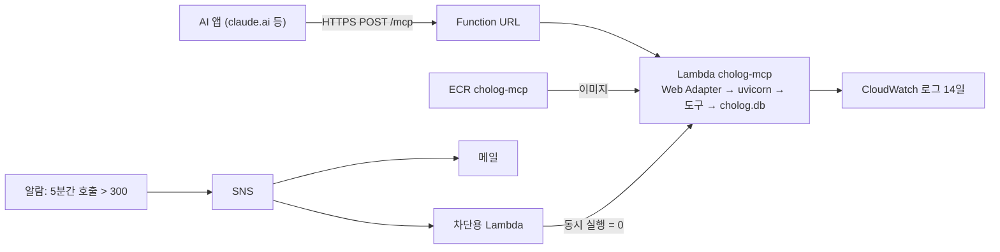

# infra

서버를 AWS Lambda에 올리는 Terraform 코드. 다른 계정으로 옮길 때도 이 순서를 그대로 따른다.



| 파일 | 내용 |
|---|---|
| `main.tf` | ECR, Lambda(arm64, 512MB, 30초), Function URL(인증 없음), 로그 그룹 |
| `kill_switch.tf` | 차단 스위치. 호출이 급증하면 서버 함수의 동시 실행 수를 0으로 바꿔 모든 요청을 막는다 |
| `variables.tf` | 이미지 태그, 허용 Host, 알림 메일, 차단 기준 |
| `terraform.tfvars.example` | 개인 값 예시. `terraform.tfvars`로 복사해 쓴다 (git에 올리지 않는다) |

state(`terraform.tfstate`)는 지금 이 폴더의 로컬 파일이다. git에 올리지 않는다.

## 준비

- Terraform 1.16 이상, AWS CLI 2.32 이상(`aws login`), Docker
- root가 아닌 IAM 사용자로 로그인한다. 액세스 키를 파일에 두지 않는다.

```bash
aws login --profile cholog --region ap-northeast-2
export AWS_PROFILE=cholog
cp terraform.tfvars.example terraform.tfvars   # image_tag, alert_email을 채운다
terraform init
```

## 처음 배포

Lambda는 만들 때 ECR에 이미지가 있어야 하고, 서버가 받을 Host(Function URL 도메인)는 URL을 만든 뒤에야 정해진다. 그래서 처음 한 번은 나눠서 apply한다.

```bash
# 1. ECR만 만든다
terraform apply -target=aws_ecr_repository.server -target=aws_ecr_lifecycle_policy.server

# 2. 이미지를 올린다 (저장소 루트에서, 데이터 data/cholog.db가 있어야 빌드된다)
REPO=$(terraform -chdir=infra output -raw ecr_repository_url)
TAG=$(git rev-parse --short HEAD)
aws ecr get-login-password | docker login --username AWS --password-stdin ${REPO%%/*}
docker build --platform linux/arm64 -t $REPO:$TAG .
docker push $REPO:$TAG

# 3. 나머지를 만든다 (terraform.tfvars의 image_tag = 위의 TAG)
terraform apply

# 4. Host를 넣는다
terraform output -raw function_url_host     # 이 값을 terraform.tfvars의 allowed_hosts에 넣는다
terraform apply
```

3번 직후에 요청하면 `421 Invalid Host header`가 정상이다. Web Adapter가 원래 Host 헤더를 그대로 넘기기 때문이다.

메일로 SNS "Subscription Confirmation"이 온다. 링크를 눌러야 차단 알림을 받는다.

## 새 이미지 배포

```bash
docker build --platform linux/arm64 -t $REPO:$TAG . && docker push $REPO:$TAG
terraform apply -var image_tag=$TAG       # 또는 terraform.tfvars의 image_tag를 바꾼다
```

ECR은 태그 덮어쓰기를 막아 두었다(같은 태그로 다시 push할 수 없다). 태그는 커밋 해시를 쓴다.

## 확인

```bash
URL=$(terraform output -raw function_url)mcp
curl -s $URL -H 'Accept: application/json, text/event-stream' -H 'Content-Type: application/json' \
  -d '{"jsonrpc":"2.0","id":1,"method":"tools/list"}'
aws logs tail /aws/lambda/cholog-mcp --since 10m          # 실시간은 --follow
```

## 차단 스위치

막혔는지 확인하고 다시 연다.

```bash
aws lambda get-function-concurrency --function-name cholog-mcp   # 0이면 막힌 상태
aws lambda delete-function-concurrency --function-name cholog-mcp
```

공격 없이 시험하려면 알람 상태를 바꾼다. 몇 초 안에 막히고(요청이 429), 메일이 한 통 온다. 끝나면 위 명령으로 다시 열고 알람을 OK로 돌린다.

```bash
aws cloudwatch set-alarm-state --alarm-name cholog-mcp-invocations-spike --state-value ALARM --state-reason "시험"
aws cloudwatch set-alarm-state --alarm-name cholog-mcp-invocations-spike --state-value OK --state-reason "시험 끝"
```

Terraform은 동시 실행 수를 관리하지 않는다(`ignore_changes`). apply가 차단을 몰래 풀지 않게 하기 위해서다. 차단 중에도 `terraform plan`은 "No changes"다.

## 알아둘 것

- **Function URL 권한은 선언하지 않는다.** 인증 없는 URL에 필요한 권한 두 개(`lambda:InvokeFunctionUrl`, URL로 온 `lambda:InvokeFunction`)는 AWS provider가 URL을 만들 때 자동으로 넣는다. 따로 선언하면 같은 ID로 충돌(409)한다. destroy해도 지워지지 않는다.
- **함수별 동시 실행 제한은 걸지 않았다.** 계정 동시 실행 한도가 10이면 함수에 떼어줄 수 없다(계정에 10은 남겨야 한다). 0으로 막는 것은 공용 몫을 가져가지 않아서 한도 10에서도 된다.
- **로그 그룹은 함수보다 먼저 만든다.** Lambda가 자동으로 만들면 보관 기간이 "영구"가 된다.
- **Function URL은 다시 만들면 바뀐다.** 다른 계정으로 옮기면 URL이 바뀌므로, 사용자에게 준 주소를 다시 안내해야 한다.
- Function URL은 공개 저장소에 적지 않는다. 인증이 없어서 아는 사람은 누구나 부를 수 있다.

## 다른 계정으로 옮기기

1. 새 계정에서 위 "처음 배포"를 그대로 한다.
2. 새 URL을 AI 앱에 다시 등록한다.
3. 옛 계정에서 `terraform destroy`로 지운다. ECR은 이미지가 남아 있어도 지워진다(`force_delete`).
